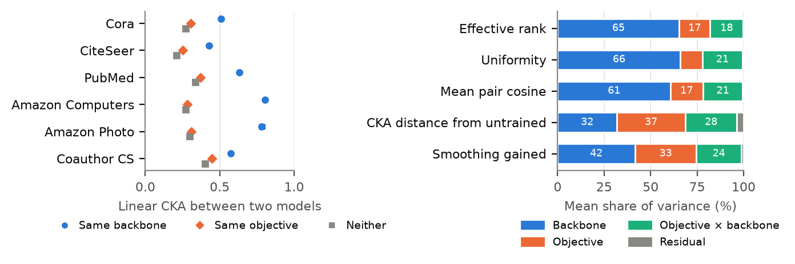
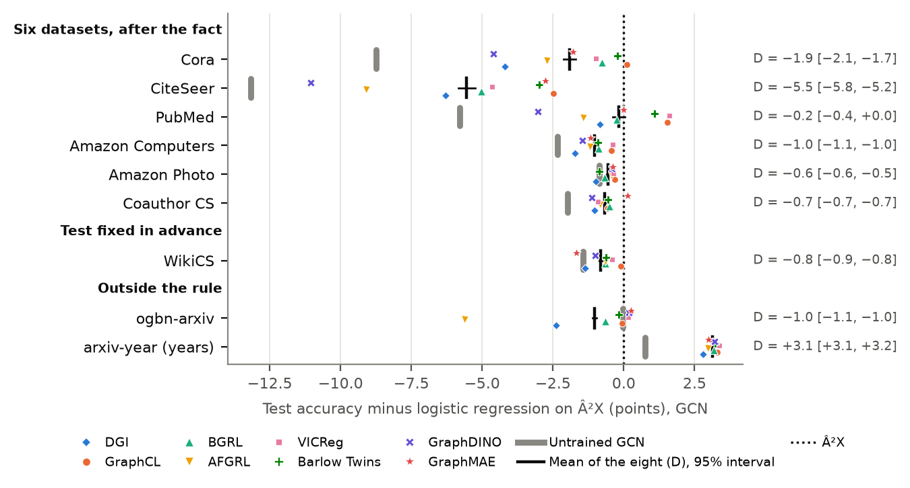
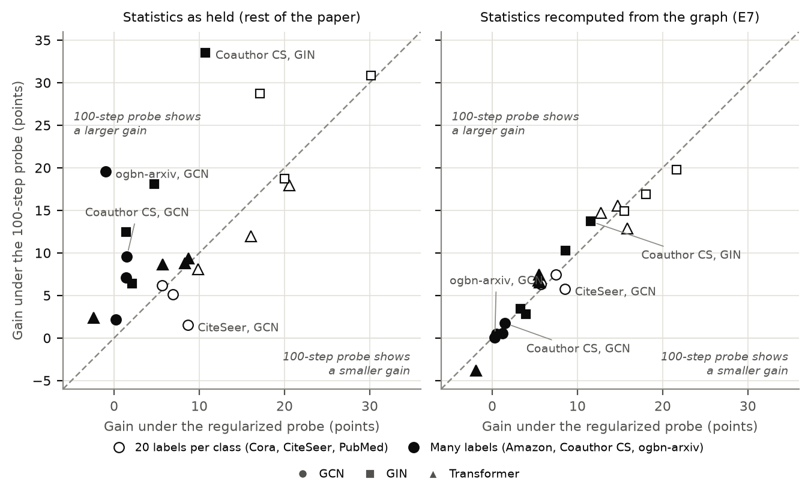
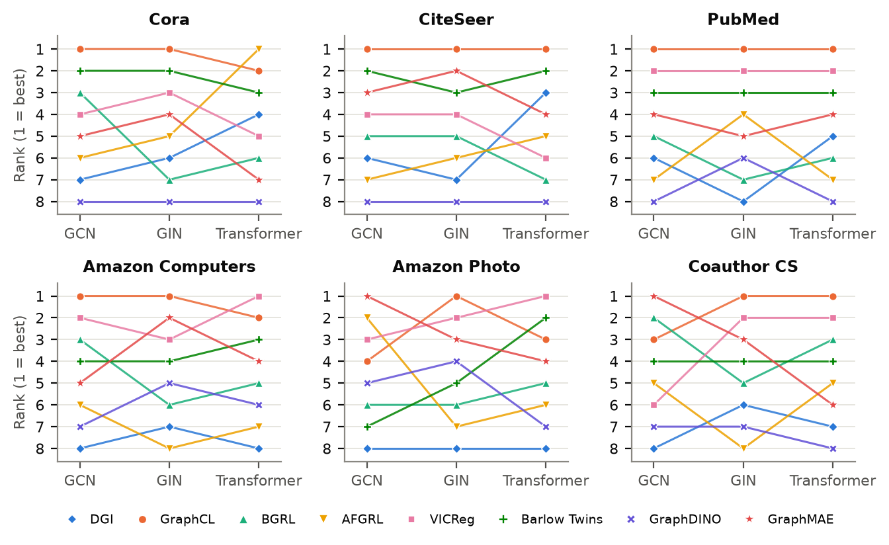
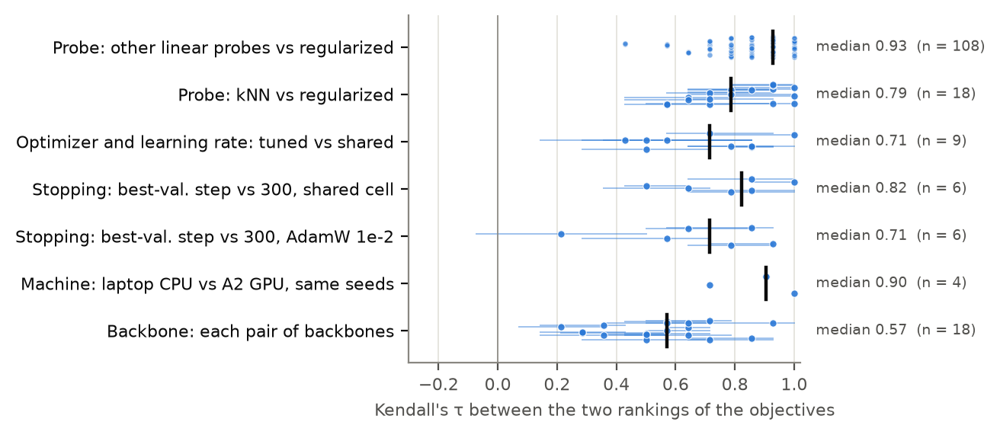

# Evaluation Study

Graph self-supervised learning (SSL) methods are compared by the accuracy of a linear classifier
fitted on frozen node embeddings, on the assumption that a difference in that number comes from
the pretraining objective. GraphSSL is the instrument of a controlled study of that assumption:
how much of a reported result is the objective, and how much is the encoder it was trained with,
the classifier that scores it, the data split, the seed and the training settings? A paper is in
preparation; this page summarizes the design and the findings.

## Design

- **Eight objectives from six families**: mutual information (DGI), contrastive learning with
  negatives (GraphCL, which at the node level coincides with GRACE), bootstrapping without
  negatives (BGRL, AFGRL), redundancy reduction (VICReg, Barlow Twins), self-distillation
  (GraphDINO) and masked feature reconstruction (GraphMAE).
- **Three backbones**: a 2-layer GCN, GIN and graph Transformer (256 units, batch norm).
- **Six datasets**: Cora, CiteSeer and PubMed (public split), Amazon Computers, Amazon Photo and
  Coauthor CS (a random 10/10/80 split as the standard one); and **ogbn-arxiv**, trained with
  neighbor sampling, also scored on its publication-year labels (arxiv-year), which neighbors
  rarely share.
- **One shared, untuned protocol**: 300 full-batch steps, AdamW (lr `5e-4`), edge dropping and
  feature masking, 10 seeds (3 on ogbn-arxiv). It compares objectives at equal budget; the
  experiments below measure what that choice costs.
- **Train once, evaluate many ways.** Every model is saved. SSL training never sees a label, so
  the same embeddings are scored again with the linear probes of four public codebases (100 or
  5,000 Adam steps, liblinear, and `LogRegEvaluator`, which standardizes the embeddings and
  chooses its L2 penalty on validation), with kNN, and on ten random splits.
- **Three references for every number**: the same encoder left **untrained** (same architecture
  and seed, scored identically), logistic regression on the **raw features**, and logistic
  regression on the features **propagated twice over the graph** (²X, the features of SGC),
  which trains nothing. Raw → ²X is what the graph adds without parameters; ²X → untrained is
  what random weights keep of it; untrained → trained is what the objective adds.

| Experiment | What varies | Levels |
|---|---|---|
| E1 | objective × backbone | 8 objectives, untrained encoder, 2 supervised references; 3 backbones; 6 datasets and ogbn-arxiv |
| E2 | probe × split × labels | 4 published linear probes, 3 controls, kNN; standard and 10 random splits; arxiv-year |
| E3 | optimizer × learning rate | AdamW and SGD, 5 learning rates each; every backbone on Cora and CiteSeer, GCN on the Amazon and Coauthor graphs |
| E4 | training step | 14 evaluations between step 0 and 300, in three optimizer cells (Cora, CiteSeer) |
| E5 | training budget | 300 against 3,000 steps (GCN on Cora and the Amazon and Coauthor graphs; GIN and Transformer on Cora) |
| E6 | reference without parameters | raw X, ÂX, ²X and the first 256 principal components of ²X, under the probes of E2, on every dataset; WikiCS, used nowhere else, as an out-of-sample test (E1 and E2 there) |
| E7 | normalization statistics | every model of E1 on the six datasets and ogbn-arxiv evaluated with the statistics its batch-norm layers hold and with statistics recomputed from one pass over the graph |
| E8 | input features | row-normalized instead of raw features; GCN, Cora, CiteSeer, PubMed, 5 seeds |
| M | — | label-free metrics of every saved model: CKA between models, effective rank, uniformity, smoothing |

Seven analyses had their decision rules committed before the results they apply to: the label-free
prediction test, the definitions summarizing the trajectories of E4, the rules of E3 and E5 on
the Amazon and Coauthor graphs, the test of E6 on WikiCS, and the rules of E7 and E8. The rules are in `benchmarks/paper/PREREG.md`, verbatim.

## Representations resemble their backbone more than their objective


- **Most of what an encoder contributes needs no parameters.** Averaging the features twice over
  the graph (²X) puts logistic regression 21.8, 9.9 and 6.8 points above the raw features on
  Cora, CiteSeer and PubMed. An untrained GCN applies the same propagation with random weights in
  between and loses part of it: it is 0.9 to 13.2 points below ²X on every dataset, though still
  above the raw features on Cora, PubMed and the Amazon graphs. An untrained GIN or Transformer
  is weaker still. (Input-feature rows are scored with the regularized probe, ours or liblinear,
  that is better on validation: ours standardizes, which understates sparse bag-of-words.)
- **The objectives repair weak feature maps more than they improve good ones.** With a GCN the
  average objective adds 6.9, 8.6 and 5.6 points on the citation graphs but only 1.4, 0.2 and 1.5
  on Amazon Computers, Amazon Photo and Coauthor CS; with a GIN, which starts 6 to 31 points
  lower, it adds 1.4 to 30.1.
- **Models resemble their backbone, not their objective.** Two models that share a backbone have
  a linear CKA of 0.43 to 0.81, two that share an objective 0.25 to 0.45, barely above two that
  share neither. It holds across random initializations, and the masked autoencoder is no
  exception. With ten times the training budget the grouping weakens below the margin fixed in
  advance: it is a property of the shared budget.
- **The backbone's share of the gain depends on the reference.** It explains 68 to 82% of the
  variance of the gain over the untrained encoder on four of the six datasets, much of it the
  distance between the untrained encoders. With the untrained encoder's normalization statistics
  recomputed from the graph (E7) that share falls on five of the six datasets (Amazon Computers 68
  → 35% on the standard split). On accuracy the objective weighs more than the backbone on
  CiteSeer and Coauthor CS.



## With a GCN, training rarely beats averaging over the graph



- **On the six datasets.** Logistic regression on ²X, which has no parameters, is above the
  average GCN objective by 0.6 to 5.5 points on five datasets and level with it on PubMed (−0.2,
  interval −0.4 to 0.0), and 1.0 above on ogbn-arxiv. Over the three backbones, 16 of the 144
  trained models are above it, ten of them on Coauthor CS and Amazon Photo.
- **Under every check.** The average GCN objective stays below ²X after tuning (E3: 0.7 to 2.7
  points), with ten times the budget (E5: 0.6 to 2.5), with normalization statistics recomputed from
  the graph (E7: D moves by at most 0.1) and with row-normalized features (E8: 1.0, 5.0 and 0.3
  below on Cora, CiteSeer and PubMed); E7 and E8 have rules fixed before their runs. Without
  GraphDINO it is level on PubMed (+0.2). A GCN trained on the labels does no better (2.8 below to
  0.1 above), as SGC found with labels.
- **Tested out of sample.** This comparison was made after the results of the six datasets were
  known, so it was tested on WikiCS, a seventh dataset with dense features, under a rule fixed
  before its runs: the comparison would be restricted to the six datasets if the average GCN
  objective were at least one point above ²X. It is 0.8 points below (95% seed-bootstrap
  interval −0.9 to −0.8), and none of the 24 trained models of the three backbones is above ²X.
  The verdict holds under our probe, liblinear and the ten random splits; only the 100-step
  probe reverses it, because it fits ²X poorly (74.4%).
- **Not on labels that neighbors share less often.** On the publication years of ogbn-arxiv the
  untrained GCN is 0.7 points above ²X and every GCN objective 2.8 to 3.4 points above it.

## How the gain is measured changes its size



- **In both directions.** With a GCN, the 100-step probe of DGI and PyG-SSL measures an average
  gain of 1.5 points on CiteSeer, where the regularized probe measures 8.6, and 9.5 on Coauthor
  CS, where it measures 1.5. On ogbn-arxiv it finds gains of up to 22 points for GCN objectives
  that the regularized probe places at most 0.3 points above the untrained encoder; with the
  untrained encoder's normalization statistics recomputed from the graph, those gains are −3.1 to
  +1.1.
- **With few labels, unregularized probes overfit.** The 100-step probe fits the CiteSeer
  embeddings (training loss 0.03) and still scores them lower: it shrinks the gain.
- **With many labels, the inflation comes from the reference.** In eval mode an untrained encoder
  still holds the initial statistics of its batch-norm layers, so its embeddings are 5 to 290 times
  smaller than a trained model's with a GCN, and a short probe underfits them. One forward pass
  over the graph, with no gradient and no label, sets those statistics
  (`extract_embeddings(..., norm_stats="graph")`): the short probe's average excess over the
  regularized one, over the nine cells with many labels, falls from 6.4 to 0.6 points (E7, rule
  fixed in advance). The same statistics account for part of the gains of the GIN and the
  Transformer (Cora: 30.1 → 21.6 and 20.6 → 14.7 points) and for much of the kNN gains (Cora with a
  GIN: 39.5 → 19.0); with a GCN under the regularized probe nothing moves by more than 0.6.
- **The fix is three settings**: standardize the embeddings with the statistics of the training
  rows, choose the L2 penalty on the validation split, and evaluate the untrained encoder with
  normalization statistics from the graph. `LogRegEvaluator` does the first two.

## What survives: the order within one backbone





- The ranking of the objectives under one backbone holds across probes (median Kendall τ 0.93
  over the linear probes) and machines, and partly across learning rates and stopping steps
  (τ 0.43 to 1.00), where GraphMAE, which peaks early and prefers a low learning rate, moves most.
- **It does not hold across backbones**: τ falls to 0.21 between two backbones, and on
  ogbn-arxiv the rankings of the GIN and the Transformer are reversed (τ = −0.79). A ranking of
  graph SSL objectives is a ranking for one backbone.
- GraphCL is the best objective in 13 of the 18 dataset–backbone cells, with a lead over the
  runner-up clear of seed noise in 8 of them, and among the best three in 17. After tuning (E3) it
  is first in three of the nine groups and among the best three in all nine.

## The small gains hold against tuning and budget

The small GCN gains on the Amazon and Coauthor graphs are the result most exposed to "the
protocol is untuned". Two tests with rules fixed before their runs asked whether tuning the
optimizer and learning rate (E3), or ten times the training budget (E5), raises the average gain
by a point or more on any of the three graphs. Neither does: the mean change is at most 0.2
points with tuning and 0.4 with the longer budget. Where gains are large, tuning helps: on Cora
and CiteSeer it lifts the average objective by 1.0 to 7.6 points.

## A larger graph, and labels that do not follow the edges

- On ogbn-arxiv, with a GCN, no objective improves on the untrained encoder under the
  regularized probe (from 5.6 points below to 0.3 above), although a supervised GCN reaches
  71.74% in the OGB benchmark, about 2.5 points more. With a GIN seven of eight objectives gain,
  by up to 8.4 points; with the
  Transformer only AFGRL does. With the statistics the models hold, the probe is the largest
  factor of the gain on this graph; most of that is the untrained encoder's statistics (E7).
- On the year labels every GCN objective gains 2.0 to 2.6 points, while every GIN objective
  loses. Most of the GCN gain is the untrained encoder's normalization statistics: recomputed from
  the graph (E7), the objectives gain 0.3 points on average. A GCN beats ²X on these labels even
  untrained.

## Label-free metrics barely tell which objective helped

A test fixed in advance asked whether a metric computed without labels (effective rank, CKA
distance from the untrained encoder, neighbor smoothing gained, uniformity) picks the objective
that gains most. Only the CKA distance passes, and narrowly: the objective it ranks first loses
2.90 points against the best one, a random choice 2.99, and leaving ogbn-arxiv or Amazon Photo
out of the test set reverses the verdict. Effective rank points the wrong way: across objectives
on one backbone, a higher rank goes with a smaller gain.

## A seed does not pin a result down

The GCN and GIN models of Cora and CiteSeer were trained twice with the same seeds and
configuration, on a GPU server and on a laptop CPU. Models are initialized on the CPU, so the
initial weights match; the augmentations draw from the generator of the device that holds the
graph, so they do not. With a GCN a seed differs from its rerun by about half of what two
independent seeds differ by, with a GIN by about three quarters; the means over ten seeds and
the order of the objectives survive (τ 0.71 to 1.00). Compare means over seeds, never one seed
against the same seed on another machine.

## How much of the result is the method?


On these graphs and with this protocol, the objective explains between a quarter and a half of
the variation of a reported accuracy, part of which depends on the backbone it is paired with,
and much less of what SSL adds over the encoder it started from. The shares describe this grid
of experiments; they are not causal estimates.

## Recommendations

1. Report the untrained encoder, the raw features and the propagated features (ÂᴷX, with K the
   depth of the encoder), scored in the same way, and the gain over the untrained encoder.
2. Evaluate the untrained encoder with normalization statistics computed on the graph (one forward
   pass), or say that it holds its initial ones.
3. Regularize the probe on validation data: choose the L2 penalty, and the feature normalization
   too, on the validation split. Standardizing removes the difference in scale between trained
   and untrained embeddings but understates sparse input features. Report the solver, the grid
   and whether the fit converged.
4. Select nothing on the test split, neither the pretraining epoch nor a probe setting.
5. Use more than one backbone, or say why one is enough, and report the ranking under each.
6. Use ten seeds or more, report intervals, and compare means over seeds, not seeds across
   machines.
7. Report the trajectory, or at least whether accuracy declines after its best validation step.
8. Do not choose an objective by effective rank.

## What this does not show

- One untuned configuration per objective, and tuning beyond the optimizer and learning rate
  (augmentations, width, depth) is not studied.
- Node classification only, transductive, on graphs where neighbors tend to share labels, except
  for the year labels of ogbn-arxiv.
- The probes of other codebases are re-implementations applied to GraphSSL's embeddings, not
  runs of those codebases' own pipelines.
- The device is fixed within a dataset and experiment but differs between datasets.
- The comparison with ²X was made after the results of the six datasets were known; WikiCS is
  its only out-of-sample test, E7 and E8 its only checks with rules fixed in advance.
- Every main table evaluates the untrained encoder with its initial normalization statistics, as
  the analyses fixed in advance were defined; E7 gives the same numbers with statistics from the
  graph.

## Reproduce

Every number comes from the result files in `benchmarks/paper/`: one JSON per run with per-seed
metrics, the exact model configuration, the git commit and the package versions. Training is
driven by `benchmarks/paper_runs.sh` (Cora and CiteSeer) and `benchmarks/paper_v2.sh` (the other
datasets, ogbn-arxiv, E3, probes and metrics; see their headers) and `benchmarks/paper_e6.sh`
(E6: the input-feature rows, and training and scoring on WikiCS), and the analysis by:

```bash
P=benchmarks/paper
python benchmarks/analyze_factors.py $P/probes/*/probes__*.json --untrained-root $P/models_untrained --out $P/analysis
python benchmarks/analyze_representations.py --metrics $P/metrics/*/metrics__*.json \
  --probes $P/probes/*/probes__*.json --untrained-root $P/models_untrained --out $P/analysis
python benchmarks/analyze_e3.py           # E3: shared vs tuned, the decision rule
python benchmarks/analyze_trajectories.py # E4
python benchmarks/analyze_e5.py           # E5: training budget, the decision rule
python benchmarks/analyze_propagation.py  # E6: the propagated features, the test on WikiCS
python benchmarks/analyze_e7_e8.py        # E7, E8 and the checks of the comparison with ²X
python benchmarks/paper_figures_v2.py     # the figures on this page
```

The summaries of E3, E4 and E5, with every per-objective number, are in
`benchmarks/paper/analysis/{e3,trajectories,e5}/summary.md`. Trained models are not committed.
